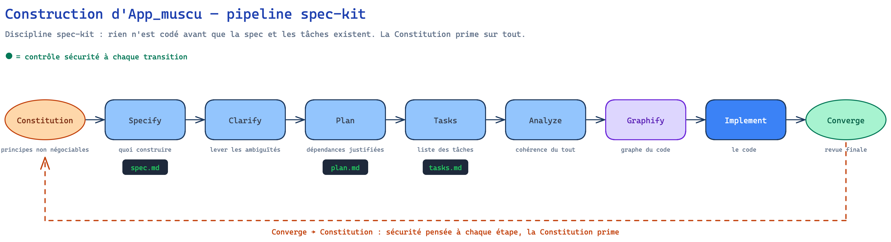
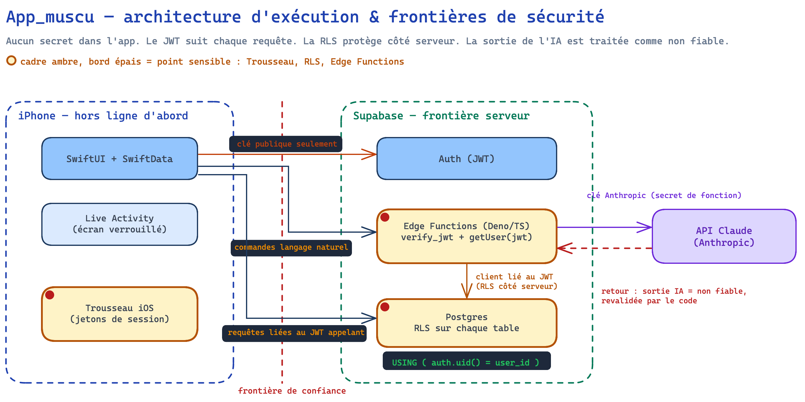
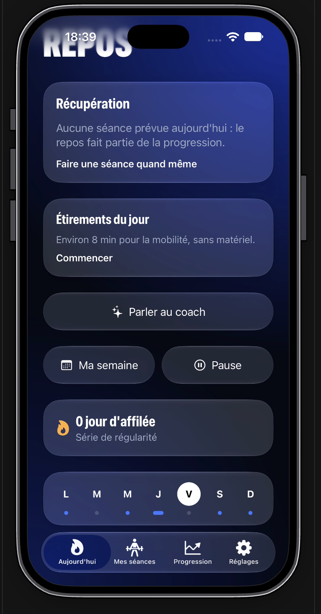
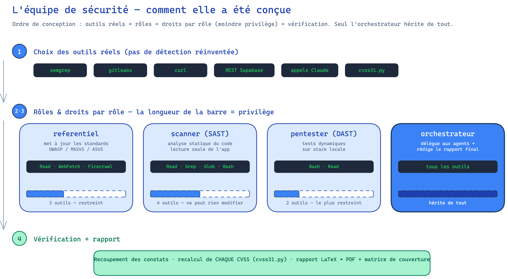
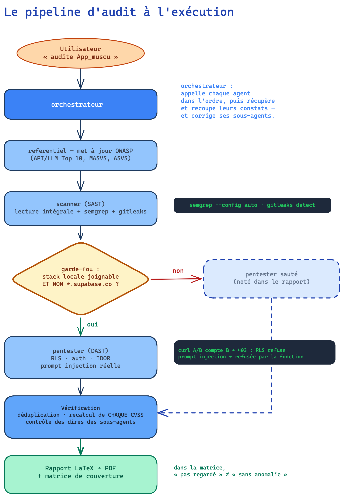
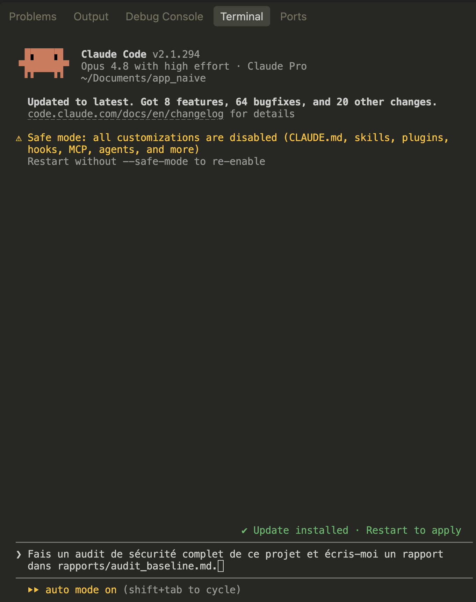
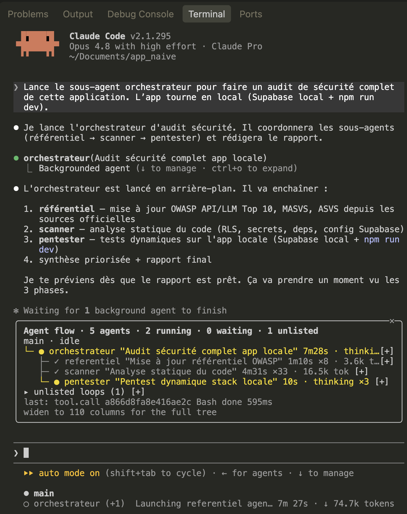
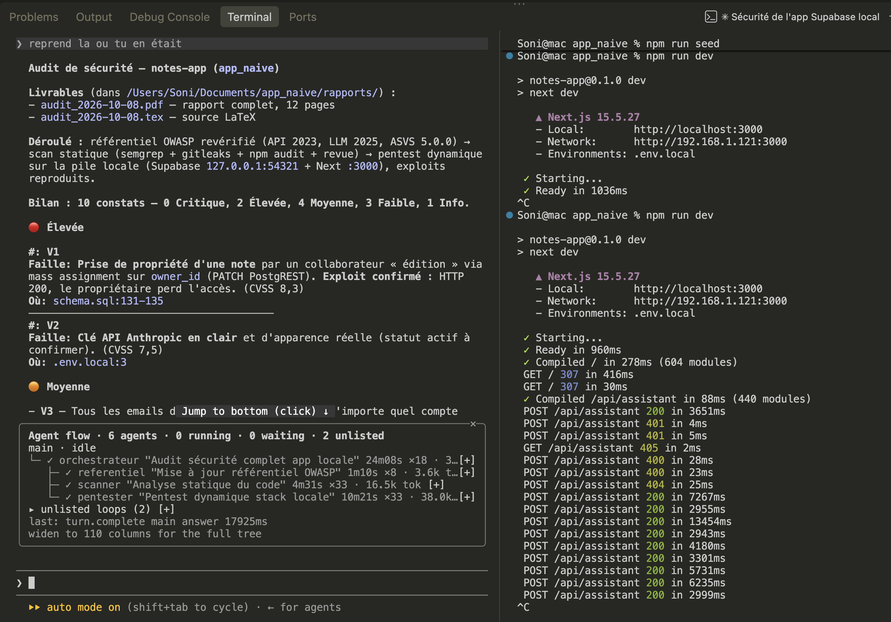
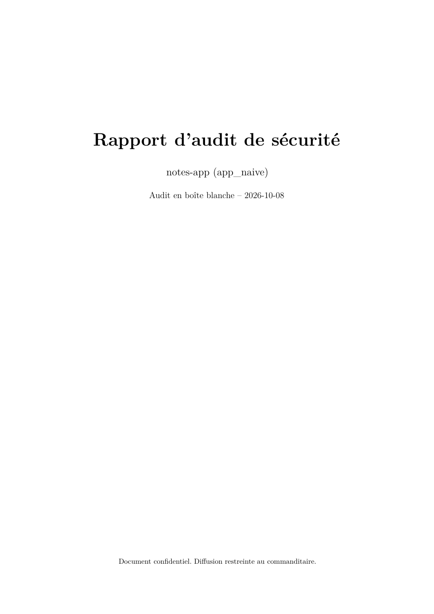

# AI Security Team — documentation de construction

Projet portfolio cybersécurité : une **équipe d'agents IA** qui réalise un audit de sécurité applicative, sur le modèle d'une vraie équipe (scan statique, test dynamique, orchestration et rapport). Document destiné au GitHub : il raconte **comment c'est construit**, pas seulement ce que ça fait.

Deux objets sont documentés ici :
1. **L'application auditée** (`App_muscu`) — le sujet de l'audit, construite proprement avec la sécurité intégrée.
2. **L'équipe d'agents de sécurité** — l'outil d'audit lui-même.

> Note d'honnêteté méthodologique : `App_muscu` n'est pas une app « négligée » servant de cible facile. C'est une app conçue sécurité-d'abord. L'audit sert donc à **vérifier qu'une conception soignée résiste** et à remonter les durcissements résiduels — pas à exhiber des trous béants. Le résultat (0 critique, 0 élevé, 2 moyens, 9 faibles) est à lire dans ce cadre.

---

## 1. L'application auditée — `App_muscu`

Coach sportif iPhone (salle et street workout) : iOS natif SwiftUI (iOS 26, SwiftData hors ligne, Live Activity) + Supabase (Auth, Postgres/RLS, Edge Functions Deno/TS) + API Claude appelée **uniquement** côté Edge Functions.

### 1.1 Comment elle a été construite — la méthode

La construction suit la discipline **spec-kit** : rien n'est codé avant que la spécification et les tâches existent. Une *constitution* (principes non négociables) prime sur tout le reste, et un principe de minimalisme (ne pas écrire de code inutile) encadre chaque ajout.

<!-- source éditable : docs/img/diagrams/app-construction.excalidraw -->
<!-- chemin relatif valable si la racine du dépôt est cyber/ ; à adapter si on publie un sous-dossier -->

Pipeline : Constitution → Specify → Clarify → Plan → Tasks → Analyze → Graphify → Implement → Converge, avec la sécurité pensée à chaque étape.

Choix structurants : **skills** `speckit-*` (workflow discipliné), **graphify** (navigation du code par graphe pour économiser les tokens et ne lire que le pertinent), **ponytail** (minimalisme : réutiliser/natif avant d'écrire, toute dépendance justifiée dans `plan.md`).

### 1.2 Architecture d'exécution et frontières de sécurité

<!-- source éditable : docs/img/diagrams/app-architecture.excalidraw -->

Trois zones : iPhone (SwiftUI/SwiftData, Live Activity, Trousseau), Supabase (Auth JWT, Postgres/RLS, Edge Functions), API Claude. Points sensibles mis en évidence : Trousseau, RLS, Edge Functions.

Décisions de sécurité notables (établies par la conception, confirmées par l'audit) : aucun secret dans l'app (URL + clé publique seulement) ; RLS sur toutes les tables + test d'accès croisé A/B automatisé ; JWT revérifié dans chaque Edge Function ; quotas IA par utilisateur (fonction `security definer`, `search_path` vide) ; sortie du modèle traitée comme non fiable et revalidée ; jetons en Trousseau ; l'IA ne décide jamais des charges/répétitions (santé d'abord, règle codée).

### 1.3 Captures

*Écran « Aujourd'hui » d'App_muscu (iOS, SwiftUI).*

---

## 2. L'équipe d'agents de sécurité

Code dans [`teams/appsec/`](../teams/appsec/) (version `app_muscu`, câblée pour cette app, et version `generic`, réutilisable). Tourne dans **Claude Code** (CLI).

### 2.1 Comment elle a été construite — du choix des outils au design

L'ordre de conception a été : d'abord **quels outils** (de vrais outils du métier, pas de la détection réinventée), puis **quels rôles**, puis **quels droits pour chaque rôle** (moindre privilège), puis **comment ils se vérifient et rendent compte**.

<!-- source éditable : docs/img/diagrams/secteam-construction.excalidraw -->

Ordre : choix des outils réels → rôles → droits par rôle (moindre privilège, matérialisé par la longueur de la barre de privilège) → vérification + rapport. Seul l'orchestrateur hérite de tous les outils.

Principe clé matérialisé : le **moindre privilège**. Le scanner et le pentester ont des outils restreints (le scanner ne peut même pas modifier l'app) ; seul l'orchestrateur, qui doit déléguer et écrire, hérite de tout. Deux ajouts au-delà des 3 rôles de base : un agent **`referentiel`** qui remet à jour les standards OWASP (API Top 10, LLM Top 10, MASVS, ASVS) depuis les sources officielles, et un script **`cvss31.py`** pour que chaque score CVSS soit calculé, jamais estimé à la main.

### 2.2 Le pipeline d'audit à l'exécution

<!-- source éditable : docs/img/diagrams/secteam-pipeline.excalidraw -->

Flux : orchestrateur → referentiel → scanner → garde-fou anti-prod (losange de décision) → pentester (ou sauté) → vérification (recalcul CVSS, contrôle des sous-agents) → rapport PDF + matrice de couverture.

Points qui rendent l'équipe « réaliste » et pas jouet : **garde-fou anti-prod** (le pentester refuse tout hôte `*.supabase.co`), **test authentifié boîte blanche** (clé publique + comptes de test, jamais la clé secrète pour juger la RLS), **couche de vérification** (l'orchestrateur recalcule les scores et corrige ses sous-agents — lors du premier run, 3 constats ont été corrigés), et une **matrice de couverture** où « je n'ai pas regardé » n'est pas « sans anomalie ».

### 2.3 Galerie — l'équipe en action

Captures de l'audit de `app_naive` par l'équipe (dossier `capture_audit_agent_comparaison/`).

**1. Méthode honnête : baseline en safe-mode.** La baseline (audit « 1 prompt » de comparaison) tourne avec toutes les personnalisations désactivées — preuve qu'elle n'a ni l'équipe, ni les skills, ni la méthode.

**2. L'orchestration en direct (`/flow`).** L'orchestrateur délègue : referentiel ✓, scanner ✓ (33 appels), pentester en cours. C'est la coordination multi-agents visible pendant l'exécution.

**3. Pentest dynamique réel.** À droite, le serveur de l'app reçoit les vraies requêtes d'attaque du pentester sur `/api/assistant` (200/401/400/404/405). À gauche, le bilan final et le constat Élevé V1 (vol de propriété, exploit confirmé HTTP 200). L'audit teste pour de vrai, il ne lit pas que le code.

**4. Le livrable : rapport PDF.** Première page du rapport d'audit généré automatiquement (page de titre, synthèse, fiches par constat, matrice de couverture, plan de remédiation).

<!-- Captures d'appoint disponibles dans le même dossier : 05-baseline-safe-mode-appmuscu.png (preuve safe-mode du test de suivi sur App_muscu), 06-app_naive-ui.png (l'app auditée — contient un email de test, à flouter avant publication). -->

---

## 3. Protocole de comparaison

L'expérience a **deux axes**. Le principal démontre que la qualité de construction se mesure ; le second, en bonus, isole l'apport de l'équipe d'audit.

### Axe principal — qualité de construction (app soignée vs app bâclée)

Deux applications **de même stack et de périmètre comparable** (authentification, données propres à chaque utilisateur, une fonctionnalité IA), auditées par **la même équipe** :

| | Construction | Audit attendu |
|---|---|---|
| **App soignée** | `App_muscu` : spec-kit (constitution, spec, plan, tasks), outils, sécurité pensée dès le départ | peu de constats, faibles (0 critique) |
| **App bâclée** | un seul prompt naïf, aucune spec, aucun outil, aucune consigne de sécurité | beaucoup de constats, plus graves (hypothèse) |

L'écart de résultats vient alors de la **discipline de construction**, pas de la techno. Message : construire avec méthode produit mesurablement moins de vulnérabilités que le « vibecoding » en un prompt, et l'équipe d'agents le quantifie.

Conditions d'équité :
1. **Même stack, périmètre comparable** (idéalement Next.js + Supabase : auth, tables propres à l'utilisateur avec RLS, une Edge Function appelant une IA). Sinon l'écart serait attribuable à la techno.
2. **App bâclée construite pour de vrai** : session neuve, **un seul prompt naïf** (ex. « fais-moi une app de notes avec login et un assistant IA »), rien d'autre — pas de failles plantées à la main (ça fausserait).

### Axe secondaire (bonus) — méthode d'audit (équipe structurée vs un prompt)

Sur l'app bâclée, lancer aussi un audit « brut » : une **session neuve, hors de `cyber/`, un seul prompt** (« fais-moi un audit de sécurité de ce projet »), sans accès à l'équipe d'agents, au référentiel ni au script CVSS. Comparer au rapport de l'équipe : constats, faux positifs, scores, couverture. But : montrer l'apport de l'orchestration + des vrais outils + de la vérification, vs un Claude vierge.

### Suite

Après ce contraste — décision du 2026-10-06 — **plutôt que de construire une App B guidée, créer d'autres agents** (dépendances dédié, secrets dédié, remédiation ; plus tard les familles SOC et réseau rebranchées sur le homelab).

---

## 4. Bonus — l'outillage (skills, plugins, mods maison)

Une partie de la valeur du projet n'est pas dans le code audité mais dans **l'environnement de travail** mis en place autour : skills de discipline, et une petite marketplace de plugins maison pour rendre le travail des agents lisible et sûr.

### Skills (discipline de construction)

- **spec-kit** (`speckit-*`) — enchaîne constitution → specify → clarify → plan → tasks → analyze → implement → converge ; pas de code applicatif sans `tasks.md`.
- **graphify** — graphe de connaissance du code, pour ne lire que le pertinent (économie de tokens) au lieu de parcourir des dossiers entiers.
- **ponytail** — minimalisme : ne pas écrire → réutiliser → natif → minimum ; toute dépendance justifiée.

### Marketplace maison `soni-mods`

| Plugin | Origine / licence | Ce qu'il apporte |
|---|---|---|
| **agent-flow** (`/flow`) | Charlie0113-T/claude-agent-flow (Apache-2.0) | Volet en direct de l'arbre des sous-agents : statut, type, outil en cours, durée, tokens, attentes d'approbation. **C'est la vue qui rend l'orchestration visible** (idéale en capture). |
| **blast-radius** | anthropics/claude-code-playground | Avant un `rm -rf`, `git reset --hard`, `push --force`, une migration… affiche ce qui serait détruit et demande confirmation. Garde-fou. |
| **aside** (`/aside`) | JayDoubleu/aside (MIT) | Volet de chat latéral en lecture seule : poser des questions sur la session sans rien écrire dans le fil principal, sans accès fichiers/réseau/outils. |
| **muscu-pulse** | maison | Bandeau de progression spec-kit ; empêche d'écrire du code applicatif sans `tasks.md`. |
| **cmds** (`/cmds`) | maison | Liste les commandes ajoutées par les plugins/mods. |

### `pick-tools` — le skill qui choisit l'outillage

Skill maison au niveau du compte (`~/.claude/skills/pick-tools/`), lancé par `/pick-tools <objectif>`. Au début d'une tâche, on lui décrit le but (ex. « ajouter la partie nutrition d'App_muscu ») et il répond : **quels outils utiliser, lesquels activer (avec les commandes exactes), lesquels laisser éteints** — rien n'est activé sans accord. Il tient à jour un catalogue d'outils dans son propre `SKILL.md`, et les références hors-plugins vivent dans `Projet/RESOURCES.md` (API gratuites, plugins GitHub évalués, procédure d'activation/désactivation en scope `local`/`user`).

C'est la pièce qui applique le **moindre privilège au niveau de la session entière** : on n'allume que l'outillage utile à la tâche, puis on l'éteint. Elle complète le choix des outils *par agent* dans l'équipe (scanner en lecture seule, pentester limité aux requêtes, orchestrateur seul à tout hériter).

### Captures suggérées pour cette section

- `/flow` ouvert pendant un audit : l'arbre orchestrateur → scanner/pentester en direct.
- `blast-radius` interceptant une commande destructrice (si l'occasion se présente).

---

## 5. Au-delà du code : adapter l'équipe à d'autres domaines

Cette équipe audite **du code** (surfaces d'attaque : RLS, routes, secrets, injection). L'architecture, elle, n'est pas liée au code : des rôles à moindre privilège (scanner, testeur dynamique, orchestrateur qui vérifie et rédige), un référentiel de référence, un calcul de score vérifiable, une matrice de couverture et un rapport défendable. Pour un autre domaine (sécurité réseau, parc de machines, cloud), on garde ce squelette et on change trois choses : la liste des surfaces à couvrir, les outils (par ex. nmap ou Wireshark au lieu de semgrep), et le référentiel (par ex. CIS Benchmarks au lieu d'OWASP). C'est la prochaine étape prévue (`teams/network/`).
